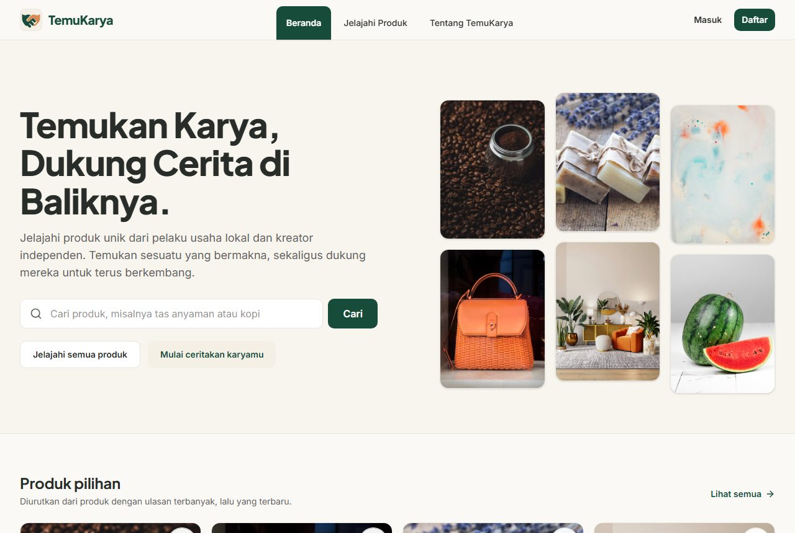
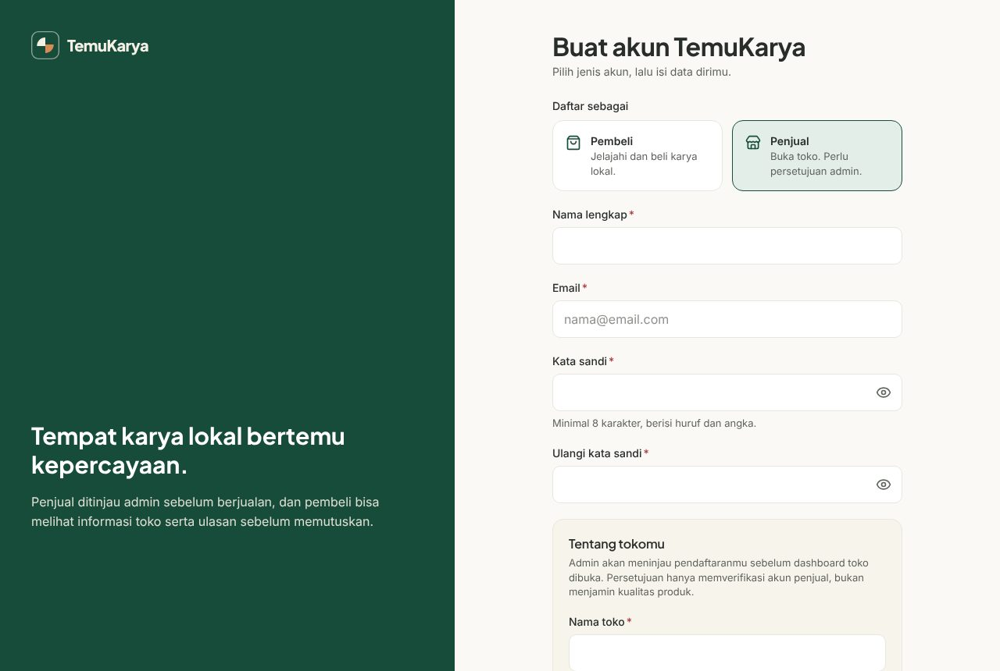
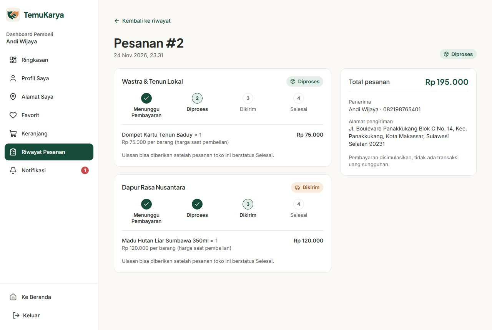
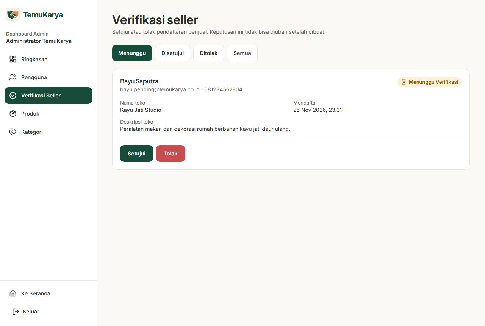
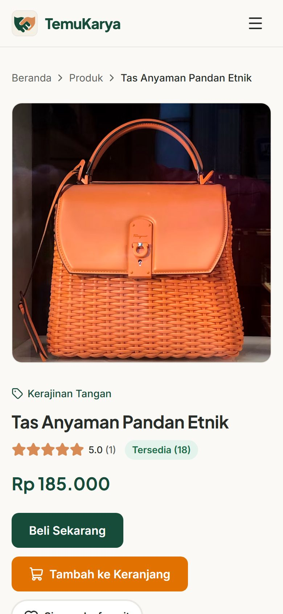
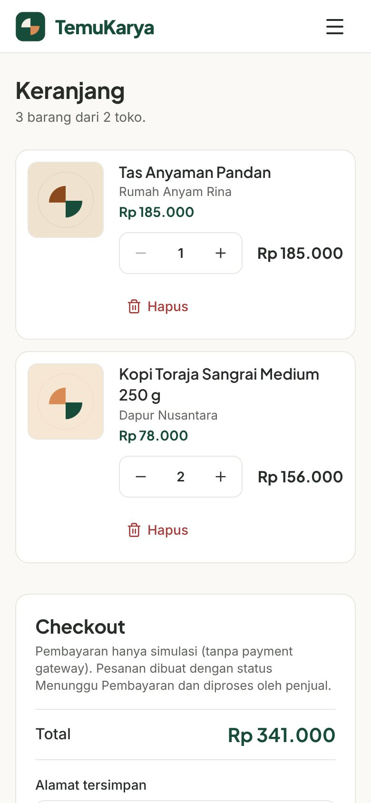

<p align="center">
  
</p>

<p align="center">
  
  
  
  
  
  <br>
  
  
  
</p>

<p align="center">
  <b>Marketplace multi-seller</b> untuk produk pelaku usaha lokal dan kreator independen.<br>
  Tugas Final Praktikum Pemrograman Web 2026 &middot; Proyek 1: E-Commerce
</p>

<p align="center">
  <a href="#-tampilan">Tampilan</a> &middot;
  <a href="#-mulai-cepat">Mulai cepat</a> &middot;
  <a href="#-fitur-per-peran">Fitur</a> &middot;
  <a href="#-cara-kerjanya">Cara kerjanya</a> &middot;
  <a href="#-api">API</a> &middot;
  <a href="#-keamanan">Keamanan</a> &middot;
  <a href="#-pengujian">Pengujian</a>
</p>

---

## ✨ Sekilas

- **Empat peran** dengan hak akses terpisah: Guest, Buyer, Seller, dan Admin. Seller baru harus disetujui Admin dulu (jika ditolak, alasan penolakan ditampilkan jelas di halaman status).
- **Satu checkout, banyak toko.** Satu pesanan otomatis dipecah per toko, dan tiap penjual hanya melihat dan memproses bagiannya sendiri.
- **Stok aman.** Checkout berjalan dalam satu transaksi database; 12 pembeli berebut 3 stok menghasilkan tepat 3 pesanan.
- **Tata kelola & moderasi aktif.** Admin wajib menyertakan alasan saat menghapus produk melanggar (otomatis masuk ke notifikasi Seller), dapat menghapus ulasan tidak pantas, menonaktifkan/mengaktifkan akun pengguna, serta memproses pengajuan hapus akun.
- **Pemotongan gambar produk interaktif.** Penjual dapat memotong foto produk (`1:1` atau `4:3`) maupun memotong ulang gambar tersimpan langsung dari form produk.
- **Dua jalur akses, satu logika.** Form memakai *Server Actions*, klien lain memakai *Route Handler* REST, dan keduanya berbagi satu lapisan aturan bisnis.
- **Rapi di semua layar.** Responsif dari 360 px, penanda tab aktif pada navigasi, 0 pelanggaran aksesibilitas (axe-core), dan dapat dioperasikan penuh dengan keyboard.

## 📸 Tampilan

### Untuk pengunjung

<table>
  <tr>
    <td width="50%"><br><sub><b>Beranda</b>: pencarian, produk pilihan, kategori, dan toko</sub></td>
    <td width="50%"><br><sub><b>Katalog</b>: cari, filter kategori, harga, rating, dan stok</sub></td>
  </tr>
  <tr>
    <td width="50%"><br><sub><b>Detail produk</b>: toko, rating, ulasan, moderasi ulasan admin, dan tombol favorit</sub></td>
    <td width="50%"><br><sub><b>Daftar</b> sebagai pembeli atau penjual (penjual menunggu persetujuan)</sub></td>
  </tr>
</table>

### Pembeli

<table>
  <tr>
    <td width="50%"><br><sub><b>Keranjang</b> dan checkout dengan alamat tersimpan</sub></td>
    <td width="50%"><br><sub><b>Pelacakan pesanan</b>: tiap toko punya status sendiri</sub></td>
  </tr>
  <tr>
    <td width="50%"><br><sub><b>Favorit</b>, terpisah dari keranjang</sub></td>
    <td width="50%"><br><sub><b>Ringkasan & Notifikasi</b> pesanan, keranjang, dan status akun</sub></td>
  </tr>
</table>

### Penjual dan Admin

<table>
  <tr>
    <td width="50%"><br><sub><b>Pesanan masuk</b>: hanya item toko sendiri, dengan aksi status</sub></td>
    <td width="50%"><br><sub><b>Produk saya</b>: CRUD, stok, dan pemotong gambar (crop & potong ulang)</sub></td>
  </tr>
  <tr>
    <td width="50%"><br><sub><b>Verifikasi seller</b> oleh Admin (Setujui atau Tolak dengan alasan)</sub></td>
    <td width="50%"><br><sub><b>Ringkasan & Tata Kelola Admin</b>: moderasi produk beralasan dan kelola akun</sub></td>
  </tr>
</table>

### Di ponsel

<p align="center">
  
  
  
  
</p>

## 🚀 Mulai cepat

> **Prasyarat:** Node.js 20.9 atau lebih baru (disarankan 22 LTS) dan PostgreSQL 13 atau lebih baru.

**1. Ambil kode dan pasang dependency**

```bash
git clone <url-repository>
cd <folder-proyek>
npm install